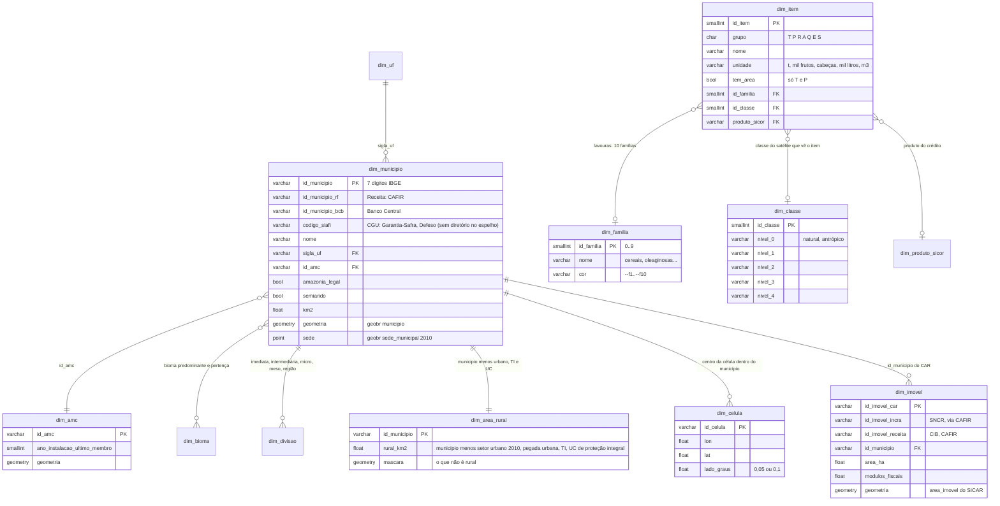

# ERD: o tema do Chão como um dataset único

Escrito em 2026-10-22. É um **schema suposto**: as tabelas `chao.*` abaixo não existem em
lugar nenhum. Hoje cada `pipeline/baixa_*.py` tira uma extração do espelho (`../rodado`, no
beelink) e a página junta tudo por município e ano dentro do navegador. Este documento
desenha o mesmo material como se fosse **um banco só, em estrela, com joins declarados**:
- as tabelas do rodado usadas pelo Chão;
- as tabelas do tema que ainda não entram (`docs/plans/dados_faltantes.md`).

O objetivo é deixar à vista o que juntaria com o quê numa integração futura. As colunas
vêm dos esquemas reais (`../rodado/docs/context/schemas.json`, 2026-10-22). Os nomes
`chao.*`, as chaves substitutas e os tipos são propostos.

Os cinco diagramas numa imagem só: [`ERD.png`](ERD.png).

Legenda das tabelas de fato:
- **✓** já entra na página (`index.html` e `site/`);
- **◐** entra em parte (só uma medida, ou só na ficha);
- **◻** está no espelho, ainda fora.

As receitas de junção do espelho inteiro (formato de cada chave, pegadinhas, contagens
de casamento) estão em `../rodado/docs/context/join_keys.md`. O mapa geral do espelho é
`../rodado/docs/mapa/ERD.md`. Este arquivo cobre só o tema.

## Convenções

| Chave | Tipo | Regra |
|---|---|---|
| `id_municipio` | `VARCHAR(7)` | Código IBGE de 7 dígitos, com zero à esquerda. **É o hub**: toda fato municipal chega aqui. |
| `id_amc` | `VARCHAR` | Área mínima comparável de 2010 (geobr). Agrega o município para séries desde 1974. Os 5 municípios de 2013 vão para a AMC de origem (`ORIGEM_2013`). |
| `ano` | `SMALLINT` | Ano civil. Tem três variantes, nunca misturadas: `ano_safra` (o ano em que a safra começa: 2023 = 2023/24), `ano_prodes` (agosto a julho) e `ano_fim_decada` (transição do MapBiomas: 2000 = 1990→2000). |
| `id_item` | `SMALLINT` | Produto da PAM, PPM ou PEVS. Hoje é o `cru` do pipeline (`"T\|Soja (em grão)"`); `grupo` ∈ T P R A Q E S. |
| `id_classe` | `SMALLINT` | Classe de cobertura do MapBiomas (`br_mapbiomas_estatisticas.classe.chave`). |
| `id_celula` | `VARCHAR` | Grade regular: `g05:<lin>:<col>` a 0,05° (glebas, perdas) ou `g10:…` a 0,1° (PRODES, focos). |
| `id_imovel_car` | `VARCHAR` | Código do imóvel no SICAR (`id_imovel`). O SICOR o carrega como `id_car`. |
| `cnpj_basico` | `VARCHAR(8)` | Empresa (raiz do CNPJ). Instituição financeira, exportador, empregador. |
| `pessoa` | — | CPF, NIS e RGP existem nas fontes, mas **não entram** no schema: a página só publica agregados (corte mínimo de 5 por célula). Nas junções futuras, use um hash com sal, nunca o número. |

## Produção e uso da terra

Todas as tabelas de fato desta parte têm o grão **município × ano**, salvo onde se indica
outro. A página reparte o total da AMC entre os membros nos anos em que o grupo está
incompleto (`porAMC`).

```mermaid
erDiagram
    dim_municipio ||--o{ fato_producao : "id_municipio"
    dim_item ||--o{ fato_producao : "id_item"
    dim_municipio ||--o{ fato_rebanho_produtivo : "id_municipio"
    dim_municipio ||--o{ fato_cobertura : "id_municipio"
    dim_classe ||--o{ fato_cobertura : "id_classe"
    dim_municipio ||--o{ fato_transicao : "id_municipio"
    dim_classe ||--o{ fato_transicao : "de e para"
    dim_municipio ||--o{ fato_desmatamento : "id_municipio"
    dim_celula ||--o{ fato_desmatamento_grade : "id_celula"
    dim_municipio ||--o{ fato_alerta_deter : "GEOCODIBGE"
    dim_municipio ||--o{ fato_foco : "id_municipio"
    dim_celula ||--o{ fato_foco : "id_celula"
    dim_municipio ||--o{ fato_emissao : "id_municipio"
    dim_item ||--o{ fato_lavoura_principal : "maior lavoura"
    dim_familia ||--o{ fato_lavoura_principal : "família que vence"
    fato_producao ||--|| fato_lavoura_principal : "derivada: soma por família"

    fato_producao {
        varchar id_municipio PK,FK
        smallint ano PK
        smallint id_item PK,FK
        float area_ha "plantada; colhida antes de 1988; null para R A Q E S"
        float quantidade "na unidade do item; permanentes só desde 2001"
        float valor_rs_mil "só desde 1994"
    }
    fato_rebanho_produtivo {
        varchar id_municipio PK,FK
        smallint ano PK
        float vacas_ordenhadas
        float ovinos_tosquiados
    }
    fato_lavoura_principal {
        varchar id_municipio PK,FK
        smallint ano PK
        smallint id_familia FK "a que soma mais área"
        smallint id_item FK "maior lavoura dentro dela"
        float pct_area_rural
    }
    fato_cobertura {
        varchar id_municipio PK,FK
        smallint ano PK
        smallint id_classe PK,FK
        float area_ha "some a repetição por bioma"
    }
    fato_transicao {
        varchar id_municipio PK,FK
        smallint ano_fim_decada PK
        smallint id_classe_de PK,FK
        smallint id_classe_para PK,FK
        float area_km2 "em km2, não ha"
    }
    fato_desmatamento {
        varchar id_municipio PK,FK
        smallint ano_prodes PK
        varchar bioma PK
        float km2_incremento
        float km2_acumulado
        float km2_deter_desmatamento
        float km2_deter_degradacao
        float km2_cicatriz_queimada
    }
    fato_desmatamento_grade {
        varchar id_celula PK,FK
        smallint ano_prodes PK
        float km2
    }
    fato_alerta_deter {
        bigint id_alerta PK
        varchar id_municipio FK
        date data
        varchar classe "desmatamento, degradação, cicatriz"
        float area_km2
        geometry geometria
    }
    fato_foco {
        bigint id_foco PK
        varchar id_municipio FK
        varchar id_celula FK
        timestamp data_hora
        varchar satelite "só o de referência entra"
        float risco_fogo
    }
    fato_emissao {
        varchar id_municipio PK,FK
        smallint ano PK
        varchar setor PK
        varchar categoria PK
        float tco2e_ar5
    }
```

| Fato | Origem no rodado | Chave de origem → hub | No Chão |
|---|---|---|---|
| `fato_producao` | `br_ibge_pam.lavoura_temporaria`, `lavoura_permanente`; `br_ibge_ppm.efetivo_rebanhos`, `producao_origem_animal`, `producao_aquicultura`; `br_ibge_pevs.producao_extracao_vegetal`, `producao_silvicultura` | `id_municipio` direto; `produto`/`tipo_rebanho` → `id_item` pelo `rotulo()` de `monta_pagina.py` | ✓ |
| `fato_rebanho_produtivo` | `br_ibge_ppm.producao_pecuaria` | direto | ✓ (por cabeça) |
| `fato_lavoura_principal` | derivada de `fato_producao` | — | ✓ (calculada no navegador) |
| `fato_cobertura` | `br_mapbiomas_estatisticas.cobertura_municipio_classe` (+ `classe` para os rótulos) | direto | ✓ (`classe` ◻) |
| `fato_cobertura_uf` | `cobertura_uf_classe`, `transicao_uf_de_para_anual`/`quinquenal`/`decenal` | `sigla_uf` | ◻ |
| `fato_transicao` | `transicao_municipio_de_para_decenal` | direto | ✓ |
| `fato_desmatamento` | `br_inpe_prodes.municipio_bioma`, `br_inpe_prodes_acumulado.incremento_municipio`, `br_inpe_deter.avisos`, `br_inpe_queimadas` | direto; DETER por `GEOCODIBGE` (o `MUNICIPALI` é o nome) | ✓ |
| `fato_desmatamento_grade` | `br_inpe_prodes_acumulado.desmatamento` (polígonos) | centroide → `id_celula` | ✓ |
| `fato_foco` | `br_inpe_queimadas.microdados` | direto + lat/lon → `id_celula` | ✓ |
| `fato_emissao` | `br_seeg_emissoes.municipio` (`uf` ◻) | direto | ✓ |

## Dinheiro: crédito, seguro, renda e comércio

O SICOR é o único pedaço do tema com uma **operação** como grão. Ele se liga ao município
por uma tabela-ponte, porque `operacao` só traz `sigla_uf`.

```mermaid
erDiagram
    sicor_operacao ||--|| sicor_complemento : "id_referencia_bacen, numero_ordem"
    sicor_complemento }o--|| dim_municipio : "id_municipio (só recurso controlado ou equalizado)"
    sicor_operacao }o--|| sicor_empreendimento : "id_empreendimento"
    sicor_empreendimento }o--|| dim_produto_sicor : "produto"
    sicor_operacao }o--|| sicor_fonte_recurso : "id_fonte_recurso"
    sicor_operacao }o--|| dim_instituicao : "cnpj_basico_instituicao_financeira"
    sicor_operacao ||--o{ sicor_gleba : "operação"
    sicor_gleba }o--|| dim_celula : "centroide"
    sicor_operacao ||--o{ sicor_liberacao : "operação"
    sicor_operacao ||--o{ sicor_saldo : "operação"
    sicor_operacao ||--o| sicor_desclassificada : "operação"
    sicor_operacao ||--o{ sicor_mutuario : "id_referencia_bacen"
    sicor_operacao ||--o{ sicor_propriedade : "operação"
    sicor_propriedade }o--o| dim_imovel : "id_car"
    sicor_operacao ||--o{ sicor_cooperado : "operação"
    sicor_operacao ||--o| proagro_cop : "operação"
    sicor_operacao ||--o| proagro_rcp : "operação"
    proagro_rcp ||--o{ proagro_rcp_gleba : "operação"
    proagro_rcp ||--o{ proagro_parcela : "operação"
    proagro_rcp ||--o{ proagro_sumula : "operação"
    dim_municipio ||--o{ fato_garantia_safra : "codigo_siafi"
    dim_municipio ||--o{ fato_bancos : "id_municipio"
    dim_instituicao ||--o{ fato_bancos : "cnpj_basico"
    dim_municipio ||--o{ fato_bndes : "id_municipio"
    dim_municipio ||--o{ fato_pib : "id_municipio"
    dim_municipio ||--o{ fato_exportacao : "id_municipio"
    dim_municipio ||--o{ fato_trase : "municipality_id_production"

    sicor_operacao {
        varchar id_referencia_bacen PK
        varchar numero_ordem PK
        smallint ano_safra_emissao
        varchar sigla_uf
        varchar id_empreendimento FK
        varchar id_fonte_recurso FK
        varchar id_programa
        varchar cnpj_basico_instituicao_financeira FK
        float area_financiada
        float valor_parcela_credito
        date data_inicio_plantio "calendário"
        date data_fim_colheita "calendário"
        float percentual_bonus_car
    }
    sicor_complemento {
        varchar id_referencia_bacen PK,FK
        varchar numero_ordem PK,FK
        varchar id_municipio FK
        varchar cnpj_agencia
    }
    sicor_empreendimento {
        varchar id_empreendimento PK
        varchar finalidade "custeio, investimento, comercialização"
        varchar atividade "agrícola, pecuária"
        varchar produto
        varchar modalidade
    }
    sicor_gleba {
        varchar id_referencia_bacen PK,FK
        varchar numero_ordem PK,FK
        smallint indice_gleba PK
        geometry geometria "amostra: só crédito com recurso público"
    }
    sicor_propriedade {
        varchar id_referencia_bacen PK,FK
        varchar numero_ordem PK,FK
        varchar id_car FK
        varchar id_sncr
        varchar id_cib
    }
    proagro_rcp {
        varchar id_referencia_bacen PK,FK
        varchar numero_ordem PK,FK
        varchar id_evento "seca, chuva, granizo..."
        date data_inicio_evento
    }
    fato_garantia_safra {
        varchar id_municipio PK,FK
        smallint ano PK
        int agricultores "NIS distintos"
        float valor_rs
    }
    fato_bancos {
        varchar id_municipio PK,FK
        smallint ano PK
        smallint mes PK
        varchar cnpj_basico PK,FK
        varchar id_verbete PK "financiamentos rurais"
        float valor "ESTBAN"
    }
    fato_bndes {
        varchar id_municipio PK,FK
        smallint ano PK
        varchar setor_cnae PK
        float valor_desembolsado
    }
    fato_pib {
        varchar id_municipio PK,FK
        smallint ano PK
        float va_agropecuaria
        float va
        float pib
    }
    fato_exportacao {
        varchar id_municipio PK,FK
        smallint ano PK
        varchar id_sh4 PK
        varchar fluxo PK "exportação ou importação"
        float valor_fob_usd "pela sede da empresa"
    }
    fato_trase {
        varchar id_municipio PK,FK "município de produção"
        smallint ano PK
        varchar commodity PK "soja, carne"
        varchar exportador PK
        varchar pais_destino PK
        float toneladas
        float fob_usd
        float exposicao_desmatamento_ha
    }
```

| Fato | Origem no rodado | Chave de origem → hub | No Chão |
|---|---|---|---|
| `sicor_*` | `br_bcb_sicor.operacao`, `empreendimento`, `fonte_recurso`, `instituicao_financeira`, `recurso_publico_complemento_operacao`, `recurso_publico_gleba`, `liberacao`, `saldo`, `operacoes_desclassificadas`, `recurso_publico_mutuario`, `recurso_publico_cooperado`, `recurso_publico_propriedade` | município por `recurso_publico_complemento_operacao.id_municipio`; gleba e calendário pela operação | ✓ (agregado: município × safra × finalidade × atividade × programa, corte de 5) |
| `proagro_*` | `proagro_cop`, `proagro_rcp`, `proagro_rcp_gleba` ✓; `proagro_parcela`, `proagro_sumula_julgamento`, `proagro_complemento_*` ◻ | pela operação; o `id_evento` ainda por `CASE`, não pelo `dicionario` | ◐ |
| `fato_garantia_safra` | `br_cgu_garantia_safra.garantia_safra` ✓; `pagamento`, `favorecido` ◻; `br_cgu_beneficios_cidadao.garantia_safra` ◻ | `codigo_municipio_siafi` (4 dígitos, sem diretório no espelho): junte como **inteiro** (como texto casam 1.106 de 1.327) | ✓ |
| `fato_bancos` | `br_bcb_estban.municipio` (`agencia` ◻) | direto | ✓ |
| `fato_bndes` | `br_bndes_desembolsos.mensal` ✓; `br_bndes_operacoes_contratadas.*` ◻ | direto | ✓ |
| `fato_scr_uf` | `br_bcb_scrdata.dados` | `uf` (sem município) | ◐ (na ficha) |
| `fato_pib` | `br_ibge_pib.municipio`, `municipio_antigo` | direto | ✓ |
| `fato_exportacao` | `br_me_comex_stat.municipio_exportacao`, `municipio_importacao` (`ncm_*` ◻) | direto; `id_sh4` → `NCM_SH` | ✓ |
| `fato_trase` | `br_trase_supply_chain.soy_beans`, `beef` (+ armazéns, esmagadoras, frigoríficos) | `CAST(municipality_id_production AS VARCHAR)` | ✓ |

## Gente, trabalho e clima

```mermaid
erDiagram
    dim_municipio ||--o{ fato_trabalho : "id_municipio"
    dim_municipio ||--o{ fato_familias : "id_municipio"
    dim_municipio ||--o{ fato_seguro_defeso : "codigo_siafi"
    dim_municipio ||--o{ fato_populacao : "id_municipio"
    dim_municipio ||--o{ fato_clima : "id_municipio"
    dim_municipio ||--o{ dim_estacao : "id_municipio"
    dim_estacao ||--o{ fato_estacao : "id_estacao"
    dim_municipio ||--o{ fato_desastre : "id_municipio"
    dim_municipio ||--o{ fato_censo_2022 : "id_municipio"

    fato_trabalho {
        varchar id_municipio PK,FK
        smallint ano PK
        int empregos_rais "subsetor IBGE 25, em 31/12"
        int saldo_caged "seção A da CNAE, desde 2020"
        int estabelecimentos_cnefe "Censo 2022"
        int imoveis_cafir "retrato atual"
    }
    fato_familias {
        varchar id_municipio PK,FK
        smallint ano PK
        int agricultores_familiares
        int pescadores_artesanais
        int extrativistas
        int assentados
        int domicilio_rural
    }
    fato_seguro_defeso {
        varchar id_municipio PK,FK
        smallint ano PK
        int pescadores "corte de 5"
        float valor_rs
    }
    fato_populacao {
        varchar id_municipio PK,FK
        smallint ano PK
        int populacao
    }
    fato_clima {
        varchar id_municipio PK,FK
        smallint ano PK
        float chuva_mm "SISAM, modelo e satélite"
        float anomalia_pct "contra 2000-2019"
        smallint dias_sem_chuva
        float temperatura_media
        float temperatura_tarde
    }
    dim_estacao {
        varchar id_estacao PK
        varchar id_municipio FK
        point geolocalizacao
    }
    fato_estacao {
        varchar id_estacao PK,FK
        smallint ano PK
        float chuva_mm "só ano com 90% das horas"
    }
    fato_desastre {
        varchar id_municipio PK,FK
        varchar id_cobrade PK
        date data_ocorrencia PK
        varchar grupo "seca, chuva, frio..."
    }
    fato_censo_2022 {
        varchar id_municipio PK,FK
        int populacao
        int populacao_rural "a calcular por setor"
        int populacao_indigena
        int populacao_quilombola
    }
```

| Fato | Origem no rodado | Chave de origem → hub | No Chão |
|---|---|---|---|
| `fato_trabalho` | `br_me_rais.microdados_estabelecimentos`, `br_me_caged.microdados_movimentacao`, `br_ibge_cnefe.enderecos`, `br_rf_cafir.imoveis_rurais` | direto; CNEFE por `COD_MUNICIPIO` | ✓ |
| `fato_familias` | `br_mds_cadunico.indicadores_municipio` | direto | ✓ |
| `fato_seguro_defeso` | `br_cgu_seguro_defeso.seguro_defeso` (`pagamento`, `favorecido` ◻) | `codigo_municipio_siafi`, como no Garantia-Safra | ✓ |
| `fato_populacao` | `br_ibge_populacao.municipio` | direto | ✓ |
| `fato_clima` | `br_inpe_sisam.microdados` | direto | ✓ |
| `fato_estacao` | `br_inmet_bdmep.estacao`, `microdados` | `id_estacao`; estação → município por `id_municipio` | ✓ |
| `fato_desastre` | `br_sedec_desastres.reconhecimentos_vigentes` | direto (só o retrato atual) | ✓ |
| `fato_censo_2022` | `br_ibge_censo_2022.municipio`, `setor_censitario`, `terra_indigena`, `territorio_quilombola` | direto; setor pelos 7 primeiros dígitos | ◻ |
| `fato_energia_uf` | `br_mme_consumo_energia_eletrica.uf` | `sigla_uf` | ◻ |
| `fato_munic` | `br_ibge_munic.meio_ambiente` | direto | ◻ |
| `fato_transferencias` | `br_cgu_beneficios_cidadao.*` | direto | ◻ |
| `fato_trabalho_escravo` | `br_mte_listasuja.empregadores` | `sigla_uf` (sem município) | ◻ |
| `fato_diesel` | `br_anp_precos_combustiveis.microdados` | direto | ◻ |
| `fato_solar_rural` | `br_aneel_dadosabertos.empreendimento_geracao_distribuida` | `CodUFibge` e município da usina (medir) | ◻ |
| `fato_agua` | `br_ana_outorgas.captacoes` | nome + UF: `upper(trim(ing_nm_municipio))` contra o diretório | ◻ |

## Terra e imóvel: o hub que ainda falta

Hoje a página só usa **somas por município** do cadastro de terra. O imóvel rural é a
chave que ligaria crédito, fiscalização, desmatamento e cadastro **abaixo do município**:
- a gleba financiada (`sicor_propriedade.id_car`);
- o CAR (`id_imovel`);
- o embargo e o auto do IBAMA (polígono e `nome_imovel`);
- o PRODES e o DETER (polígono);
- a parcela certificada do INCRA (SIGEF, SNCI).

```mermaid
erDiagram
    dim_imovel ||--o{ car_camada : "id_imovel"
    dim_imovel ||--o{ sicor_propriedade : "id_car"
    dim_imovel |o--o{ cafir_imovel : "id_imovel_incra (SNCR)"
    dim_imovel }o--o{ incra_parcela : "interseção espacial"
    dim_imovel }o--o{ ibama_embargo : "interseção espacial"
    dim_imovel }o--o{ ibama_auto : "interseção espacial"
    dim_imovel }o--o{ fato_alerta_deter : "interseção espacial"
    dim_imovel }o--o{ sicor_gleba : "interseção espacial"
    dim_municipio ||--o{ incra_assentamento : "nome + UF"
    dim_municipio ||--o{ ibama_embargo : "cod_municipio"
    dim_municipio ||--o{ ibama_auto : "cod_municipio"

    car_camada {
        varchar id_imovel PK,FK
        varchar camada PK "app, reserva_legal, vegetacao_nativa, area_consolidada, area_pousio, uso_restrito, servidao, hidrografia"
        float area_ha
        varchar status
    }
    cafir_imovel {
        varchar id_imovel_receita_federal PK
        varchar id_imovel_incra
        varchar id_municipio FK
        float area
        varchar situacao_imovel
    }
    incra_parcela {
        bigint id_parcela PK
        varchar fonte PK "sigef, snci"
        varchar id_municipio FK "SIGEF: municipio_ como inteiro"
        float area_ha
        date data_certificacao
    }
    incra_assentamento {
        varchar cd_sipra PK
        varchar municipio "nome"
        varchar uf
        int num_familias
        float area_ha
    }
    ibama_embargo {
        bigint seq_tad PK
        varchar cod_municipio FK
        date dat_embargo
        float qtd_area_embargada
        varchar deter_prodes "origem do alerta"
        geometry geom_area_embargada
    }
    ibama_auto {
        bigint seq_auto_infracao PK
        varchar cod_municipio FK
        date dat_hora_auto_infracao
        float val_auto_infracao
        varchar tipo_infracao "flora entra"
        geometry wkt_ge_area_autuada
    }
```

| Fato | Origem no rodado | Chave de origem → hub | No Chão |
|---|---|---|---|
| `car_camada` | `br_sfb_sicar.area_imovel`, `app`, `reserva_legal`, `vegetacao_nativa`, `area_consolidada`, `area_pousio` ✓; `uso_restrito`, `servidao_administrativa`, `hidrografia` ◻ | `id_municipio` direto; o imóvel por `id_imovel` | ◐ (soma por município) |
| `cafir_imovel` | `br_rf_cafir.imoveis_rurais` | `id_municipio` | ◐ (contagem) |
| `incra_parcela` | `br_incra_acervo.sigef_parcelas`, `snci_parcelas` | SIGEF: `CAST(municipio_ AS VARCHAR)`; SNCI: `uf_municip` é UF | ◐ (área por município) |
| `incra_assentamento` | `br_incra_acervo.assentamentos` | nome + `uf` | ◐ |
| `ibama_embargo` | `br_ibama_embargos_novo.termo_embargo` (+ `itens`, `coordenadas`, `decisao` ◻) | `cod_municipio` direto | ✓ (contagem e área) |
| `ibama_auto` | `br_ibama_autos.auto_infracao` (+ `bioma`, `coordenada`, `enquadramento`, `especime` ◻) | `cod_municipio`; junta direto com o `GEOCODIBGE` do DETER | ✓ (flora) |

## Referência: malhas e diretórios

| Dimensão | Origem no rodado |
|---|---|
| `dim_municipio` | `br_bd_diretorios_brasil.municipio` (5.571; carrega `id_municipio_rf`, `_bcb`, `_tse`, `_6` e as divisões) + `br_geobr_mapas.municipio`, `sede_municipal` |
| `dim_uf`, `dim_divisao` | `br_geobr_mapas.uf`, `regiao`, `pais`; divisões pelo diretório |
| `dim_bioma`, recortes | `br_geobr_mapas.bioma` (Amazônia de 2004: em 2019 a geometria é NULL), `semiarido`, `amazonia_legal` |
| `dim_area_rural` | `br_geobr_mapas.setor_censitario_2010`, `pegada_urbana`, `terra_indigena`, `unidade_conservacao` |
| `dim_amc` | `br_geobr_mapas.area_minima_comparavel_2010` (o `br_ibge_amc.municipio_de_para` foi descartado: não cobre 2013 e tem `id_amc` nulo) |
| `dim_classe` | `br_mapbiomas_estatisticas.classe` |
| `dim_instituicao` | `br_bcb_sicor.instituicao_financeira` |
| `NCM_SH`, `PAIS` | `br_bd_diretorios_mundo.*` (via `join_keys.md`) |

## O que a integração destravaria

1. **Crédito × desmatamento no imóvel.** Partindo da `sicor_gleba`:
   - ao CAR, por `sicor_propriedade.id_car`;
   - ao PRODES e ao DETER, por interseção;
   - ao embargo do IBAMA, pelo polígono.

   Resultado: o crédito público que caiu em área embargada ou desmatada depois da safra.
   Hoje só dá para cruzar no nível do município.
2. **Perda × clima.** `proagro_rcp` (evento, data) com `fato_estacao` mais próxima e
   `fato_desastre` do município: a perda declarada contra a chuva medida.
3. **Exportação × origem.** `fato_trase` (município de produção) com `fato_producao` e
   `fato_desmatamento`: o volume exportado contra o plantado e o desmatado.
4. **Renda do campo.** `fato_garantia_safra`, `fato_seguro_defeso` e
   `fato_transferencias` contra `fato_familias` e `fato_censo_2022` (população rural).
5. **Produção × crédito por cultura.** `dim_item.produto_sicor` liga a área declarada (PAM)
   à área financiada (SICOR) da mesma cultura, município e safra. É o que o modo Calendário
   já usa só para as datas.

Toda junção por pessoa (CPF, NIS, CNPJ de pessoa física) precisa passar pelo mesmo corte
de privacidade que a página usa: só agregado, com 5 ou mais por célula.
